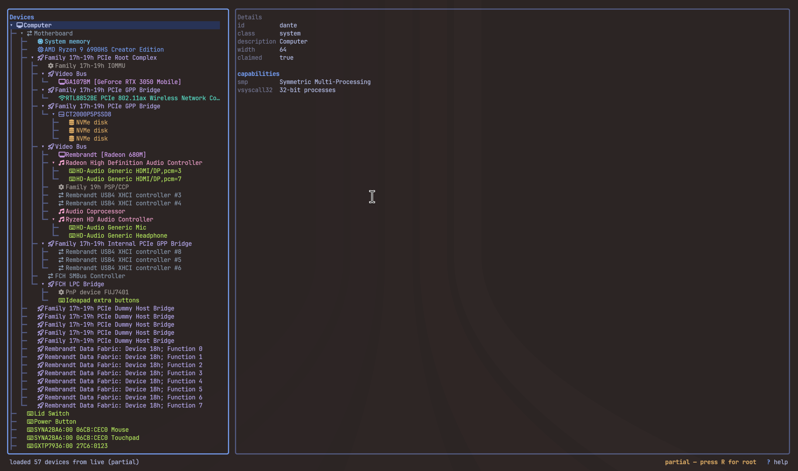

# lshwtui

[](https://github.com/susamn/lshwtui/actions/workflows/distro-test.yml)
[](https://github.com/susamn/lshwtui/actions/workflows/release.yml)
[](https://pkg.go.dev/github.com/susamn/lshwtui)
[](LICENSE)

A lazygit-style terminal UI for `lshw`. `lshw -json` dumps a wall of nested
text; `lshwtui` turns it into a navigable, collapsible tree with vim-style
keys, search, and a detail pane — so you can actually find the device you're
looking for instead of scrolling through hundreds of lines.



## Features

- Collapsible hardware tree: system > bus > device
- Detail pane with `configuration` and `capabilities` sections
- Incremental search across the tree (`/`, `n`, `N`)
- Raw-JSON view of the selected subtree
- Yank (copy) a node's detail or raw JSON to the clipboard
- Snapshot save/load — capture once, inspect later, share with a colleague
- In-app privilege escalation: re-run `lshw` as root without leaving the UI

## Requirements

- Linux — `lshw` is a Linux tool, so `lshwtui` is built for Linux only
- Go 1.24+ to build from source
- The `lshw` binary on `PATH` (e.g. `pacman -S lshw`, `apt install lshw`)
- A Nerd Font for the tree glyphs — pass `--no-glyphs` to fall back to plain
  ASCII on terminals without one

## Install

Homebrew (Linux):

```sh
brew tap susamn/tap
brew trust susamn/tap        # Homebrew requires explicit trust for third-party casks
brew install --cask lshwtui
```

DEB / RPM (Linux): download the package for your architecture from the
[latest GitHub release](https://github.com/susamn/lshwtui/releases/latest).
Packages install the binary to `/usr/bin` and depend on `lshw`.

```sh
VERSION=0.1.1  # set to the release version (without its v prefix)
# Debian / Ubuntu (amd64 or arm64: use the matching release asset)
sudo apt install ./lshwtui_${VERSION}_amd64.deb
# Fedora / RHEL-compatible (x86_64 or aarch64: use the matching release asset)
sudo dnf install ./lshwtui_${VERSION}_amd64.rpm
```

Replace `amd64` with `arm64` for ARM machines. To uninstall, run `sudo apt remove lshwtui` or
`sudo dnf remove lshwtui` respectively. Package installation does not run
`lshw` as root: launch normally for partial data, then press `R` if you want
to re-capture with elevated privileges.

Go:

```sh
go install github.com/susamn/lshwtui@latest
```

Build from source:

```sh
git clone https://github.com/susamn/lshwtui
cd lshwtui
make build          # ./lshwtui
make install        # into ~/.local/bin (override with PREFIX=)
```

`make help` lists every target; `make check` runs formatting, vet and tests.

## Usage

```sh
lshwtui                    # inspect the live hardware tree
lshwtui -f snapshot.json   # open a saved snapshot instead of live hardware
lshwtui --no-glyphs        # plain-ASCII tree, no Nerd Font glyphs
lshwtui --check            # verify hardware capture and parsing, then exit
lshwtui --version          # print version and exit
```

| Flag | Description |
|---|---|
| `-f`, `--file <path>` | Open a snapshot JSON file instead of capturing live hardware |
| `--no-glyphs` | Use plain ASCII markers instead of Nerd Font glyphs |
| `--check` | Verify hardware capture and JSON parsing without launching UI, then exit |
| `--version` | Print version and exit |

## Keybindings

### Navigation

| Key | Action |
|---|---|
| `j` / `k` | Move down / up |
| `g` / `G` | Jump to top / bottom |
| `ctrl+d` / `ctrl+u` | Half-page down / up |
| `h` | Collapse node, or jump to parent if already collapsed |
| `l` | Expand node |
| `enter` / `space` | Toggle expand |
| `tab` | Switch focus between tree and detail pane |

### Search

| Key | Action |
|---|---|
| `/` | Start incremental search |
| `n` / `N` | Next / previous match |
| `esc` | Leave raw view, or clear the search |

### View

| Key | Action |
|---|---|
| `x` | Toggle raw-JSON view of the selected subtree |
| `E` / `C` | Expand all / collapse all |
| `?` | Toggle help overlay |

### Data

| Key | Action |
|---|---|
| `y` | Yank selected node's detail to clipboard |
| `Y` | Yank raw JSON to clipboard |
| `r` | Reload from `lshw` |
| `R` | Reload via sudo/doas/pkexec (root) |
| `s` | Save current tree as a snapshot |

### General

| Key | Action |
|---|---|
| `q` | Quit |

Keybindings and CLI flags above are implemented; check the code
for what's actually wired up until the first tagged release.

## Why not just run lshw?

`lshw` and `lshw -short` are fine for a single lookup piped through `grep`.
They stop being fine the moment you want to browse: there's no folding, no
search, and no way to jump between a bus and the devices hanging off it
without re-reading hundreds of lines of indentation by eye. `lshwtui` keeps
the same data source and adds the navigation.

## Root and partial data

`lshw` only walks certain parts of the hardware tree (disk serials, some PCI
and USB detail, DMI data) when it runs as root. `lshwtui` runs unprivileged
by default — no sudo prompt just to look at your hardware — but that means
the tree you see first may be missing fields or entire subtrees.

- Unprivileged: the status bar shows a partial-data warning.
- Press `R`: `lshwtui` re-runs `lshw` through `sudo`, `doas`, or `pkexec`
  (whichever is found first) and reloads the tree with full detail.
- Snapshots loaded with `-f` are treated as already-complete captures.

## License

MIT — see [LICENSE](./LICENSE).
